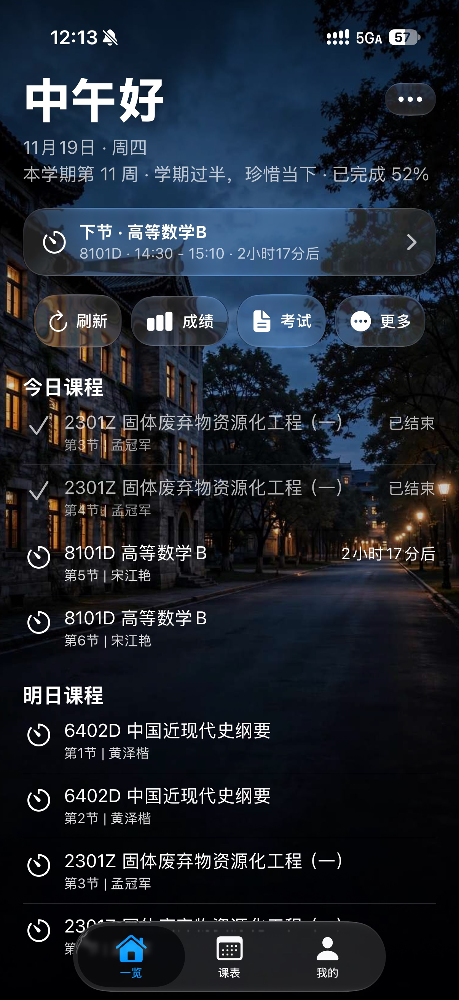
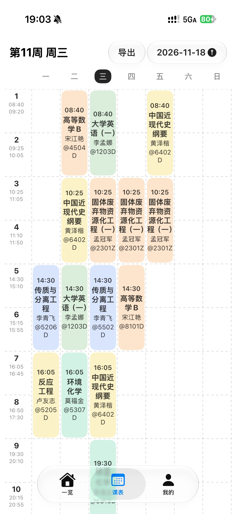
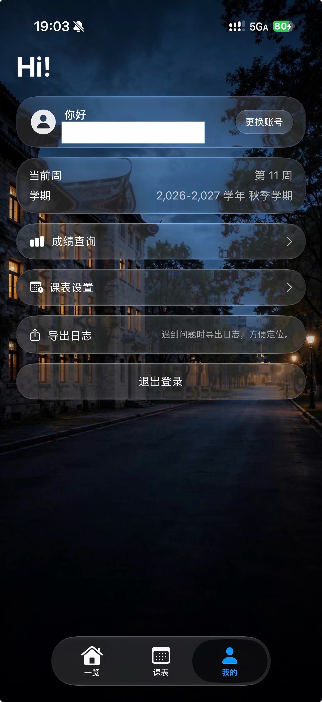

<p align="center">
  
</p>

# Glutnn-Gxunu-Assistant-Native

周周有善 —— SwiftUI（iOS 26，Liquid Glass 用系统 `.glassEffect()`）。

## 图标

应用图标是一块蓝色液态玻璃：顶部是学士帽，代表大学；中间的日历代表课表，流动的飘带代表时间；下方是桂林山水（喀斯特峰林、桥与塔），呼应两所学校所在的桂林。

## 截图

| 一览 | 课表 | 我的 |
| --- | --- | --- |
|  |  |  |

## 功能

### 双学校

- 桂林理工大学、广西职业师范学院，登录页选学校
- 账号按学校分开保存，切学校自动换回该校的账号和课表
- 切换账号不清除已保存的账号密码

### 一览（首页）

- 问候语随时间变化，显示日期、周几、本学期第几周与学期进度
- 下节课胶囊：下节课名、教室、上课时间、还有多久（正在上的课优先显示）
- 近期考试条：最多 3 条还没考的考试，按时间排序，点开看完整考试列表
- 一行四个胶囊：一键刷新课表、查成绩、看考试、更多
- 今日课程 / 明日课程：每节课的教室、节次、老师与状态（已结束 / 还有多久）
- 壁纸：校园黄昏照片、深蓝渐变、墨绿渐变、纯黑、自定义照片（从相册选取）

### 课表

- 周课表，左右滑动切换周
- 顶栏显示第几周、周几，带导出按钮与日期选择器
- 点课程块弹出详情卡片（课程名、教师、地点、周数、时间、备注）
- 导出到系统日历：按课程生成日程，上课前 15 分钟提醒
- 课表外观（我的 → 课表外观），16 项设置，改一项预览立刻变：
  - 文字：颜色、深浅、字号
  - 格子内容：显示上课时间 / 上课地点 / 教室前 @ / 授课老师 / 备注
  - 格子外观：圆角半径、不透明度、边框颜色、虚线边框、边框用格子颜色
  - 文字叠加格子颜色、文字水平与垂直居中、自定义格子高度
  - 显示非本周课程（带不透明度）、纯色背景与背景颜色、表头颜色
  - 显示网格辅助线、节数栏显示时间、显示周六 / 显示周日
  - 16 色淡色盘，每门课按名字顺序分色
  - 设置按学校 + 学号保存，登录就是你调好的那套，再调就覆盖
- 课表数据（我的 → 课表数据）：
  - 时间管理：自定义每节课的上下课时间，保存后课表与首页立即生效
  - 桂工调课开关（默认关）：打开后按教务调课记录调整课表

### 成绩

- 成绩列表，平均绩点 / 平均分
- 学年、学期筛选（顶栏选择器）

### 考试

- 考试安排查询：课程、时间、地点、座位、校区
- 区分已考与未考，未考的按时间排序

### 更多（职师院专属，首页 → 更多）

- 毕业进度：总要求学分与已修得、在修、还差，按课程性质拆分
- 学分：已选课程与总学分
- 教学执行计划：本学院各专业培养方案概览，本专业有标记
- 培养方案：官方培养方案 PDF，点开直接看
- 学生评教：待评课程与提交情况（打分请在教务网页完成）
- 毕设：已选题数与选题列表（大一为空）
- 待办事项：调课、补课等提醒，未读有蓝点
- 通知公告：学校通知，只读列表，点开看全文
- 个人信息：年级、学院、专业、班级与照片
- 学籍预警：风险课程与预警学分，没有预警会显示对勾
- 生涯预估：培养计划进度、课程通过情况

### 更多（桂工专属，首页 → 更多）

- 教学计划：按学期查看，基础信息 + 通过 / 未通过统计
- 空教室查询：按楼栋、按周查空教室，11 节占用情况
- 生涯预估：培养计划进度、课程通过情况

### 我的

- 个人信息（姓名、学号）、当前周、学期
- 更换账号
- 课表外观：16 项课表外观设置
- 课表数据：时间管理、桂工调课开关
- 提醒设置：上课提醒（提前几分钟）、考试提醒（提前几天）
- 首页设置
- 通用设置：启动自动刷新、成绩显示方式、清除缓存（不清账号密码）、备份导入导出
- 学期设置：开学日期、总周数，按学校保存
- 日历自动同步：自动把课表同步到系统日历，可选同步范围
- 关于：版本信息、项目链接
- 导出日志：遇到问题时导出日志，方便定位；支持清空
- 退出登录

### 提醒与同步

- 上课提醒：系统通知，提前分钟数可调
- 考试提醒：系统通知，提前天数可调
- 日历自动同步：课表自动同步到系统日历，同步范围可选
- 备份：设置与课表缓存导入导出（不含账号密码），导入后提醒自动重排

### 登录与会话

- 桂工登录：验证码预检，验证码错了直接提示，不发登录请求
- 职师院登录：验证码会话复用，登录失败自动探针确认
- 会话过期时提示重新验证，不会把登录状态清掉

## 学校

两个学校，默认桂工：

- 桂林理工大学（GUT，jw.glutnn.cn）
- 广西职业师范学院（GXVNU，jw.gxvnu.edu.cn，正方教务系统）

## 工程信息

- 语言：Swift 6，SwiftUI
- Deployment Target：iOS 26.0（需要 Xcode 26）
- Bundle ID：`com.h2sy60.GlutnnGxunuAssistant`
- 显示名：周周有善
- 版本：1.1.0（build 78）

## 构建（未签名 IPA）

每次推 `main`（改 `GlutnnGxunuAssistant/` 或工程文件）都会触发 GitHub Actions（macOS runner + `xcodebuild`，`CODE_SIGNING_ALLOWED=NO`），产物是 `Glutnn-Gxunu-Assistant-Native-unsigned-ipa`。每次构建成功后会自动删掉之前所有的旧构建，Actions 里只留最新一次构建（连同它的 IPA）。拿到 IPA 后用全能签 + 企业证书重签安装。

本地构建（需要 Xcode 26）：

```sh
xcodebuild -project GlutnnGxunuAssistant.xcodeproj \
  -target GlutnnGxunuAssistant \
  -configuration Release \
  -sdk iphoneos \
  CODE_SIGNING_ALLOWED=NO CODE_SIGNING_REQUIRED=NO CODE_SIGN_IDENTITY="" \
  build
```
